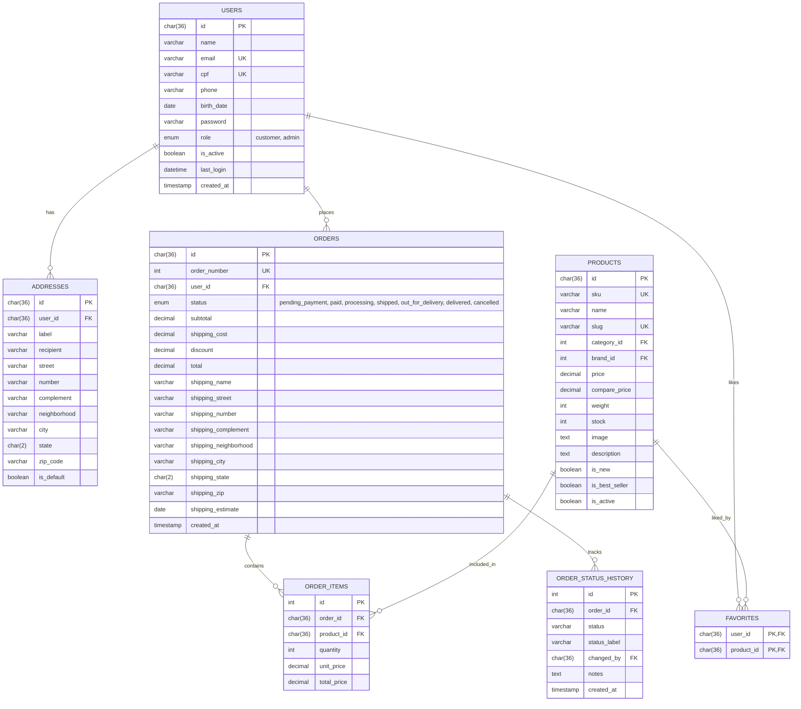

# ESSENZA — E-commerce System (v2.0)

### Mercado Pago Checkout Pro

O checkout local oferece **Mercado Pago (Pix, cartão ou boleto)**. A cliente entra na conta, cria o pedido e é redirecionada ao Checkout Pro. O status só muda para pago após o webhook consultar o pagamento na API do Mercado Pago e conferir valor, moeda e pedido. O retorno pelo navegador não aprova o pedido.

**Recebedora definida:** a chave Pix `biancaaraujo.s@hotmail.com` já está cadastrada no Mercado Pago, conforme informado. O Checkout Pro não recebe uma chave Pix como parâmetro de destino: os valores entram na conta vendedora dona das credenciais usadas no servidor. Antes de ativar pagamentos reais, confirmar no painel Mercado Pago que o `MP_ACCESS_TOKEN` de produção pertence à mesma conta em que essa chave está cadastrada. Não usar credenciais de outra conta.

Para publicar:

1. Executar `migrations/2026-10-09-mercado-pago.sql` no banco já existente antes de enviar o código. Em uma instalação nova, `database.sql` já contém o método.
2. Configurar `MP_ACCESS_TOKEN` da **conta Mercado Pago onde está cadastrada a chave `biancaaraujo.s@hotmail.com`** somente no servidor. Configurar também `MP_EXPECTED_COLLECTOR_ID` com o Cust ID dessa mesma conta, conferido independentemente no painel Mercado Pago. Na Hostinger, pode-se definir esses nomes como constantes em `public_html/includes/config.php` (arquivo já protegido por `includes/.htaccess`) se não houver mecanismo de variáveis de ambiente. A API de preferências retorna `collector_id` e o checkout bloqueia links de outra conta. Não colocar o token em HTML, JavaScript, ZIP de implantação ou Git.
3. Configurar webhook de **Pagamentos** no painel Mercado Pago para `https://essenzamodaeperfumaria.com/api/mercado-pago/webhook` e salvar a chave de assinatura como `MP_WEBHOOK_SECRET` no servidor, pelo mesmo mecanismo do passo 2. O PHP precisa da extensão cURL.
4. Usar `MP_USE_SANDBOX=1` somente com credenciais de teste, quando for preciso redirecionar ao checkout de teste. Em produção, deixar sem essa variável.
5. Validar em ambiente de teste: preferência criada, redirecionamento, pagamento aprovado, recusado e pendente, webhook repetido, total com frete e atualização de pedido no painel. Só depois publicar os arquivos.

Os meios efetivamente oferecidos pelo Checkout Pro dependem da configuração da conta Mercado Pago. A interface nova apresenta somente o Checkout Pro; Pix, cartão e boleto são escolhidos no ambiente do provedor. O backend ainda reconhece pedidos históricos com métodos anteriores.

Professional e-commerce platform for women's fashion and perfumaria, optimized for production on shared hosting (Hostinger) with a lightweight, secure PHP backend and modern vanilla JS/CSS frontend.

Production URL: [https://essenzamodaeperfumaria.com/](https://essenzamodaeperfumaria.com/)  
Local Dev Server: [http://localhost:5500](http://localhost:5500) (running Node.js with built-in mock database engine)

### Atualização da loja — Coleção Outono 2026

- Campanha “✦ Coleção Outono 2026” e navegação com Perfumes, Body Splash, Cuidados Corporais, Roupas e Acessórios.
- No painel administrativo, selecione a categoria e escolha uma foto PNG, JPG ou WebP do computador, de até 5 MB. A imagem tem prévia; editar sem escolher outro arquivo mantém a foto atual. Os arquivos ficam em `public_html/uploads/products`, que precisa permitir escrita pelo PHP.
- Frete grátis na primeira compra, limitado a um pedido por CPF cadastrado, sem valor mínimo. Pedidos pendentes e cancelados também entram no histórico. As demais compras usam a tabela de frete por estado e peso existente.
- As novas categorias são criadas ao salvar produtos; não é necessário reimportar o banco existente. A validação do benefício é feita novamente no servidor ao criar o pedido.
- Validação local: `node tests/store-updates.cjs`. O teste usa um banco temporário e remove a imagem enviada ao terminar. O servidor local simula a API; a implantação PHP/MySQL deve ser validada no ambiente de hospedagem.

---

## 📂 Project Structure

```
├── database.sql               # Database schema (20 relational tables)
├── serve-local.cjs            # Local Node.js server with Mock API database
├── serve-local-db.json        # Persistent database for local testing
├── README.md                  # Detailed system documentation
└── public_html/               # Webroot folder to deploy on Hostinger
    ├── index.html             # Store Frontpage (catalog, cart, login modais)
    ├── minha-conta.html       # Customer Dashboard (profile, orders, addresses)
    ├── admin.html             # Admin Dashboard (stats, products CRUD, order manager)
    ├── styles.css             # Main styling & layout tokens
    ├── setup-admin.php        # Initial admin setup script (delete after use!)
    ├── .htaccess              # API Rewrite rules & security headers
    ├── css/
    │   ├── account.css        # Customer dashboard styles
    │   └── admin.css          # Admin dark theme panel styles
    ├── js/
    │   ├── app.js             # Store Core logic (catalog, pagination, API integration)
    │   ├── auth.js            # Authentication modais & session management
    │   ├── cart.js            # Mini-cart popups, WhatsApp checkout & syncing
    │   ├── account.js         # Addresses CRUD, profile edit, order toggles
    │   ├── orders.js          # Order helper wrappers
    │   └── admin.js           # Admin stats rendering, catalog CRUD & order status
    ├── includes/
    │   ├── .htaccess          # Deny direct access to config files
    │   ├── config.php         # Database credentials & server variables
    │   ├── database.php       # PDO MySQL singleton connector
    │   ├── helpers.php        # Clean UUID generator, masks & helpers
    │   ├── security.php       # Rate limiting, CSRF validation, XSS escaping
    │   └── auth-middleware.php# User session validator & roles checking
    └── api/
        ├── index.php          # Main API router (handles all /api/ routing)
        ├── auth.php           # Authentication endpoints (login, register, logout)
        ├── users.php          # User profile updater
        ├── addresses.php      # Customer address list & CRUD
        ├── products.php       # Product catalog CRUD
        ├── favorites.php      # Favorites storage
        ├── cart.php           # Persistent cart syncing
        └── admin.php          # Admin stats aggregation, order status updates
```

---

## 🗄️ Database Diagram

Below is the entity-relationship model of the Essenza system:



---

## 🔒 Security Features

1. **Password Hashing**: BCrypt (`password_hash` with `cost=12`) is strictly used on registration and login.
2. **SQL Injection Prevention**: Forced PDO prepared statements on all operations; no raw queries are permitted.
3. **CSRF Protection**: Tokens are generated on session start, sent with header `X-CSRF-Token` for `POST/PUT/DELETE` methods, and validated.
4. **XSS Protection**: HTML-safe escaping on all rendering. Content-Security-Policy (CSP) headers declared in `.htaccess`.
5. **Session Isolation**: Automated ID regeneration on login/logout. Inactive session timeout after 30 minutes.
6. **Rate Limiting**: Integrated rate limits on auth login attempts (max 5 attempts per 15 minutes by IP).

---

## ⚙️ How to Deploy on Hostinger

### Step 1: Database Setup
1. Log in to your Hostinger hPanel.
2. Go to **Databases > MySQL Databases** and create a database named `YOUR_DATABASE_NAME`.
3. Open **phpMyAdmin** for this database.
4. Import the `database.sql` file. This creates all 20 tables and populates base products.

### Step 2: Code Upload
1. Upload the contents of the `public_html` directory directly into your Hostinger server's `/public_html/` root folder (keep files inside `css`, `js`, `includes`, `api` organized in subfolders).

### Step 3: Server Configuration
Ensure `public_html/includes/config.php` has correct MySQL credentials:
```php
define('DB_HOST', 'localhost');
define('DB_NAME', 'YOUR_DATABASE_NAME');
define('DB_USER', 'YOUR_DATABASE_USER');
define('DB_PASS', 'YOUR_DATABASE_PASSWORD');
define('APP_ENV', 'production'); // Use 'development' for local PHP tests
```

### Step 4: Run Admin Setup Script
1. Navigate to: `https://essenzamodaeperfumaria.com/setup-admin.php`
2. This creates the initial admin user:
   - **User**: `YOUR_ADMIN_EMAIL`
   - **Password**: `YOUR_ADMIN_PASSWORD`
3. **CRITICAL SECURITY REQUIREMENT**: Immediately delete the `setup-admin.php` file from the Hostinger server using File Manager.

---

## 💻 Local Testing & Development

You can test the entire platform locally without a PHP environment using the Node.js server wrapper:

1. Start the server (runs on port 5500):
   ```bash
   node serve-local.cjs
   ```
2. Open `http://localhost:5500` in your browser.
3. You can immediately log in with mock credentials:
   - **Customer Account**: `cliente@essenza.com` / Password: `123456`
   - **Administrator Account**: `admin@essenza.com` / Password: `2026`
4. The Node.js server persists registered users, addresses, orders, status changes, and catalog updates inside `serve-local-db.json`.
